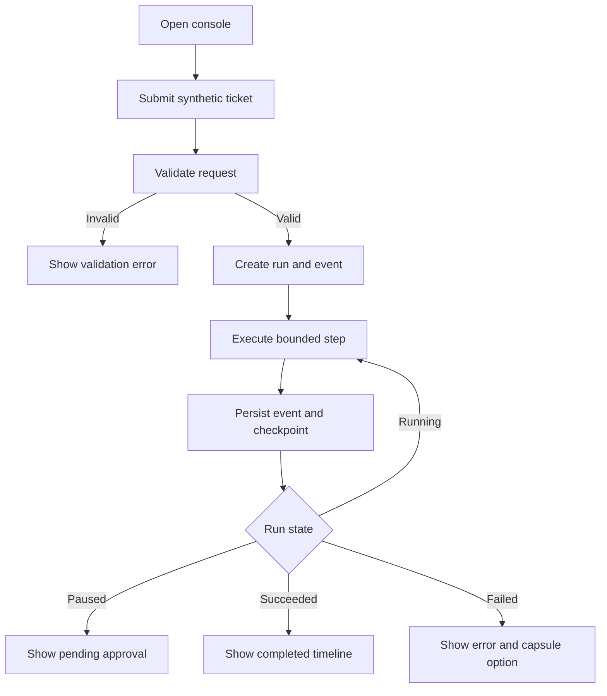
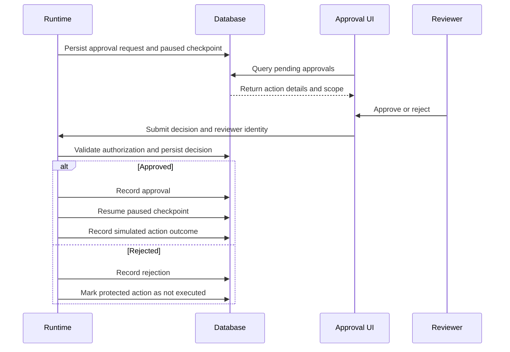
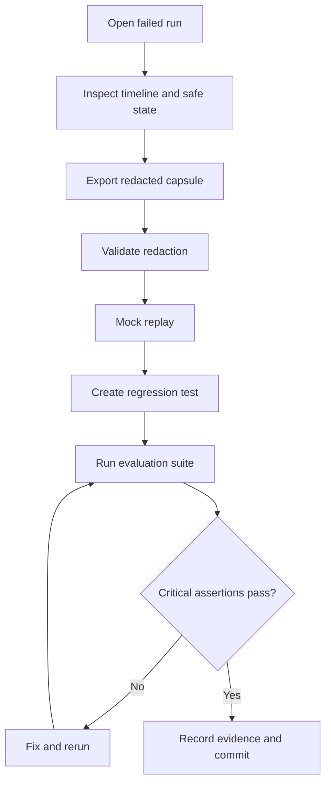

# User Flows

## A. Create and inspect a run

## B. Human approval

## C. Failure diagnosis

## UX rules
- Show lifecycle status separately from current node.
- Show exact action and scope before approval.
- Distinguish trace replay from live execution.
- Show timestamps, retries, errors, and policy decisions.
- Do not use color alone for status.
- Provide loading, empty, and failure states.

For rejection, choose one consistent safe terminal behavior (`CANCELLED` or a workflow rejection result) and document it in code/tests.
