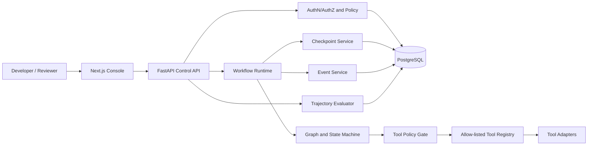
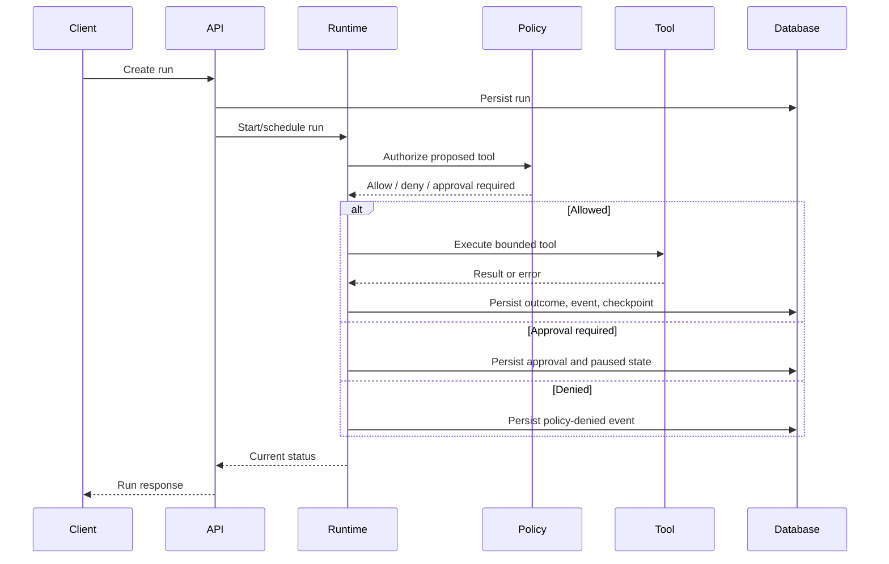

# Architecture

## Responsibilities
- **Web console:** run list, timeline, state projection, tool outcomes, errors, approvals. It is not an authorization boundary.
- **FastAPI:** validates requests and coordinates run lifecycle operations; long work belongs in a worker/scheduler, not a blocking request.
- **Runtime:** executes one bounded step, validates transitions, enforces budgets, and decides whether to continue, pause, succeed, or fail.
- **Graph/state machine:** defines legal nodes/transitions and is versioned per run.
- **Tool registry:** explicit tools with schemas, versions, timeouts, risk tier, and permissions.
- **Policy gate:** checks identity, workspace, tool, arguments, and risk in code.
- **Event service:** append-oriented, ordered, redacted run history.
- **Checkpoint service:** versioned snapshots at safe boundaries.
- **PostgreSQL:** runs, events, checkpoints, tool calls, approvals.
- **Evaluator:** deterministic tests of trajectories, outcomes, and policy compliance.

## Runtime sequence

## Trust boundaries
Browser/client to API; API to runtime; model output to tool registry; tool result to runtime; app to database; capsule export; future sandbox to host/network.

## Constraints
Runtime is independent of UI. Model providers use an adapter. Tools run only through registry and policy. Replay is mock-only by default. Do not promise exactly-once side effects across arbitrary systems.
